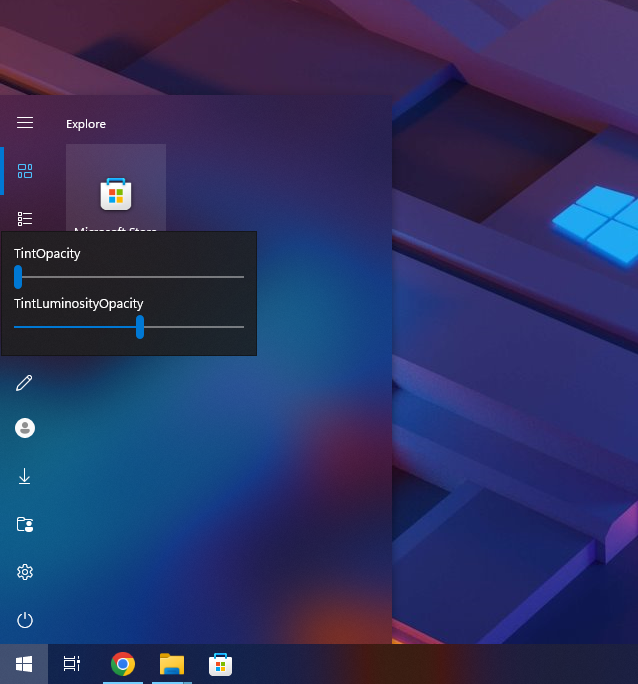
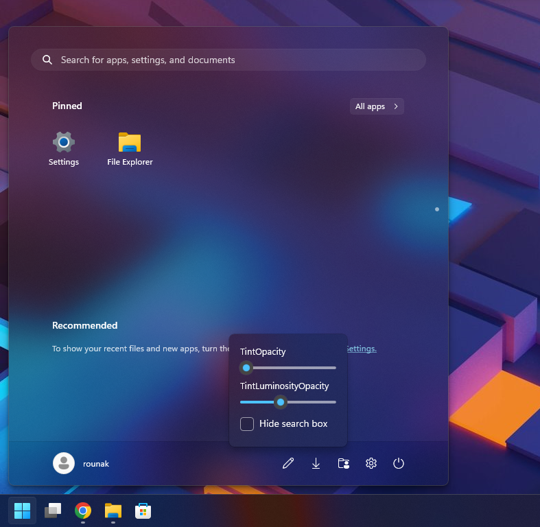

# TranslucentSM

一款轻量的 Windows 开始菜单透明化工具，可调节背景的通透效果。

程序通过 XAML Diagnostics 将 DLL 加载到开始菜单宿主进程中，修改菜单的 XAML 背景画刷。本项目 fork 自 `rounk-ctrl/TranslucentSM`，修复了 Windows 10 样式开始菜单在点击磁贴组标题时崩溃的问题，并将设置面板改为中文。

## 使用方法

1. 将 `start.exe` 和 `StartTAP.dll` 放在同一目录。
2. 打开一次开始菜单，再运行 `start.exe`。
3. 点击开始菜单中的“TranslucentSM 设置”，展开面板并调节背景效果。

设置面板中的滑块调整会立即生效，并保存到注册表。设置入口由 `EditButton` 控制，默认启用。

## 设置

配置保存在以下注册表位置，数值类型为 `DWORD`：

```text
HKEY_CURRENT_USER\SOFTWARE\TranslucentSM
```

| 面板选项 | 注册表名称 | 取值范围 | 说明 |
| --- | --- | --- | --- |
| 鲜艳程度 | `TintOpacity` | 面板 0–100，默认 70；注册表默认 30 | 滑块已反转：面板值 = 100 − 注册表值，调整时按此换算保存。 |
| 通透程度 | `TintLuminosityOpacity` | 面板 0–100，默认 70；注册表默认 30 | 滑块已反转：面板值 = 100 − 注册表值，调整时按此换算保存。 |
| 隐藏搜索框 | `HideSearch` | 0 或 1，默认 0 | 隐藏开始菜单的搜索框。 |
| 隐藏白色边框 | `HideBorder` | 0 或 1，默认 0 | 隐藏开始菜单的白色边框。 |
| 隐藏推荐项目 | `HideRecommended` | 0 或 1，默认 0 | 隐藏开始菜单的推荐区域。 |
| 设置入口 | `EditButton` | 0 或 1，默认 1 | 控制是否在开始菜单中显示设置入口。 |

开关项中，`0` 表示关闭，`1` 表示开启。面板中显示的选项取决于当前开始菜单的结构。

**直接修改注册表后，需要重新启动 `StartMenuExperienceHost.exe`，再运行本工具，使设置重新应用。退出启动器不会自动移除已加载的 DLL 或撤销效果。**

## 已验证的修复

在 Windows 11 配合 ExplorerPatcher 使用 Windows 10 样式开始菜单时，修复了点击磁贴组标题进入编辑状态导致开始菜单崩溃的问题。

## 截图





## 许可证

本项目遵循 [GNU GPL v3](LICENSE)，原项目的版权声明保留在源码和资源文件中。
